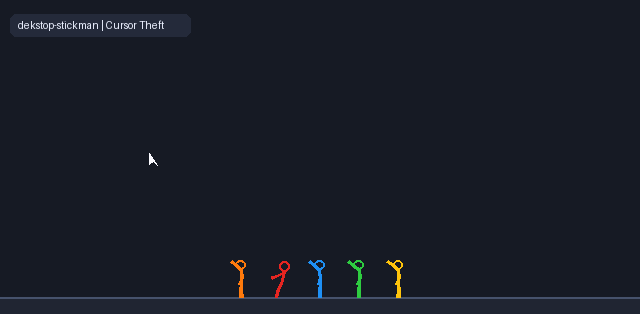

# desktop-stickman — v4



**desktop-stickman** is a lightweight Windows desktop overlay where animated stickmen live on your screen: they react to your cursor, typing, audio, CPU heat, battery level, and local weather, play harmless pranks (drawn on the overlay—never touching your real files or windows), and sit on a couch when you watch videos.

---

## Key Features

### Start with Windows
- **Tray option:** Right-click the tray icon → **«Запускать вместе с Windows»** (Start with Windows).
- Stores the executable path in `HKCU\Software\Microsoft\Windows\CurrentVersion\Run` under `desktop-stickman` (no admin rights required, toggleable anytime).

### Cursor Games & Reactions
- **Chase, Ride, Fight, Theft:** Move the cursor nearby to trigger a chase; swipe fast so a stickman hops on and rides it; spam right-click and they punch it or steal a drawn copy of the cursor for a couple of seconds.
- **Gestures:** Beckon a stickman to come over and nod; wave back; pet their head for hearts and squinting eyes.

### Harmless Desktop Pranks (Overlay-Only)
- **Fake Screen Crack:** Runs to the screen edge, swings a drawn hammer, cracks the glass, and patches it with tape.
- **Drawn Icons, Tabs & Folders:** Hides a drawn shortcut behind their back, kicks a drawn icon like a ball, accidentally knocks off a browser tab and tapes it back, or brings a drawn folder to your cursor.
- **Send Button Guard:** When you type fast in a chat window, a stickman sits on a drawn "Send" button and guards it.

### Everyday Companion & Hardware Awareness
- **Video & Couch Mode:** Detects media windows + audio and spawns a couch with popcorn and lemonade. Stickmen can even drag the couch to the edge of the screen.
- **CPU Overheat:** Reads `GetSystemTimes`; when CPU load stays high, a red heat bar glows at the top—stickmen cool it down with a fire extinguisher or plug into a drawn wall socket.
- **Battery & Weather (100% Offline):** Reads `GetSystemPowerStatus` every 5 seconds (shows `%` and ⚡/⚠ in the tray tooltip; below 15% on battery they panic). Weather (rain/snow/clear) is computed locally from the calendar month (`GetLocalTime`)—no internet or external DLLs.
- **Tea Break & Pet Mood:** Shared squad mood, tray feeding, tea break reminders (15 / 30 / 45 / 60 min), and night pajamas (23:00–06:00).

---

## Global Hotkeys (20 total)

- `Ctrl+Alt+S` — Toggle visibility
- `Ctrl+Alt+H` — Wave hello
- `Ctrl+Alt+P` — Drop a snack under cursor
- `Ctrl+Alt+B` — Drop a ball
- `Ctrl+Alt+V` — Toggle couch
- `Ctrl+Alt+L` — Toggle mini-desk
- `Ctrl+Alt+I` — Hide/show drawn icon
- `Ctrl+Alt+K` — Bring drawn folder to cursor
- `Ctrl+Alt+O` — Write a note on notepad
- `Ctrl+Alt+U` — Show sword duel
- `Ctrl+Alt+Q` — Quit

*(Full list of 20 hotkeys is available in the tray menu.)*

---

## Browser Preview (`desktop-stickman_Preview.html`)

A **single-file, 100% offline** HTML5 Canvas preview (`desktop-stickman_Preview.html`, ~112 KB) with no external links, CDNs, or modules—just double-click it to test all 67 poses and v4 scenes in Chrome, Edge, or Firefox.

---

## Building from Source (Windows / MinGW-w64)

```bat
build.bat
```

Requires MinGW-w64 (`g++`, `windres`) in `PATH`. Compiles into a single static `desktop-stickman.exe` linking only standard Windows system DLLs (`gdiplus`, `dwmapi`, `user32`, `gdi32`, `shell32`, `ole32`, `uuid`, `advapi32`).

## Verification Tools

```bash
node tools/fk_check_pose.js ../desktop-stickman_Preview.html
node tools/harness_preview.js ../desktop-stickman_Preview.html
python3 tools/v3_pose_check.py
```
